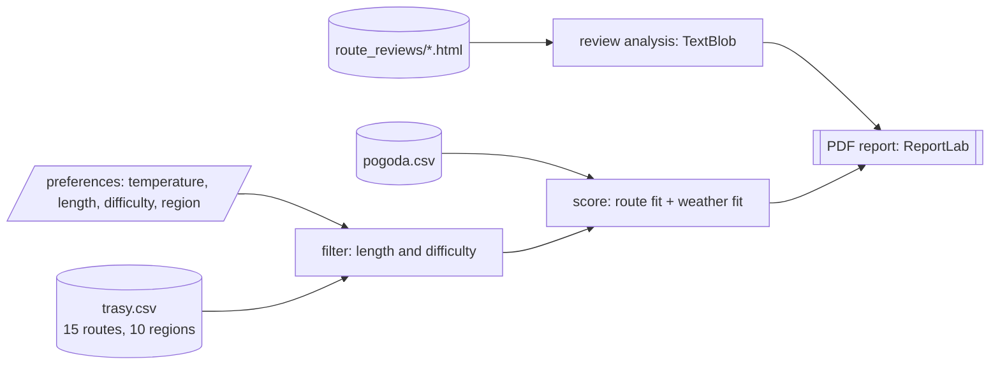

# Tourist route recommender

[Polski](README.md) | **English**


A console application that suggests hiking routes for a chosen day. You pick a temperature range, route length and difficulty, and a region. The program compares them with the weather forecast, scores every route and writes a PDF report with charts.

## How it works

1. Loads routes from `data/trasy/trasy.csv` (15 routes in 10 regions) and weather data from `data/pogoda/pogoda.csv`.
2. Drops routes outside the length and difficulty limits.
3. For each remaining route, computes how well the weather in its region fits (temperature, rainfall, cloud cover) and how well the route itself fits (difficulty and length), then combines the two with weights.
4. Saves a PDF report to the `raporty/` folder.



All data comes from files in the repository, so the program does not need internet access.

## PDF report

- elevation profiles of the routes,
- comparison charts (length, difficulty, categories),
- a heatmap of availability across the year,
- a summary table,
- an appendix with data sources and the scoring method.

The report uses the DejaVu Sans font, so Polish characters render correctly on any system.

## Running

Requires Python 3.9 or newer.

```bash
git clone https://github.com/MataKomandos/System-rekomendacji-tras-turystycznych.git
cd System-rekomendacji-tras-turystycznych

python -m venv venv
venv\Scripts\activate            # Linux/macOS: source venv/bin/activate

pip install -r requirements.txt
python main.py
```

The program asks for your preferences (in Polish): minimum and maximum temperature, route length, difficulty (1-5) and region. The report goes to `raporty/`.

## Tests

```bash
pip install -r requirements-dev.txt
pytest
```

The tests cover the weather comfort index, rejecting days with too much rainfall, filtering routes by limits, sorting results, skipping regions without weather data, and the average rating from reviews.

## Structure

```
main.py                     entry point
data/
├── trasy/trasy.csv         route descriptions
├── pogoda/pogoda.csv       weather data
└── route_reviews/          route reviews (HTML)
src/
├── models/                 Trasa, DanePogodowe, PreferencjeUzytkownika
├── recommenders/           route scoring and sorting
├── analyzers/              weather and review analysis
├── data_handlers/          data loading, route ratings
├── interface/              console handling
└── reports/                charts and PDF generator
tests/                      pytest tests
raporty/                    generated reports (not in git)
```
