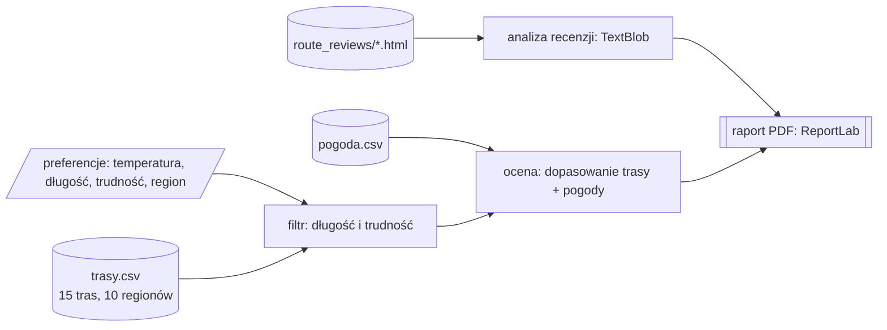

# Rekomendator tras turystycznych

**Polski** | [English](README.en.md)


Aplikacja konsolowa, która podpowiada trasy piesze na wybrany dzień. Wybierasz zakres temperatur, długość i trudność trasy oraz region, a program porównuje je z prognozą pogody, ocenia każdą trasę i zapisuje raport PDF z wykresami.

## Jak to działa

1. Wczytuje trasy z `data/trasy/trasy.csv` (15 tras w 10 regionach) i dane pogodowe z `data/pogoda/pogoda.csv`.
2. Odrzuca trasy, które nie mieszczą się w limitach długości i trudności.
3. Dla każdej pozostałej trasy liczy dopasowanie do pogody w jej regionie (temperatura, opady, zachmurzenie) oraz dopasowanie samej trasy (trudność i długość), a następnie łączy je wagami.
4. Zapisuje raport PDF do katalogu `raporty/`.



Wszystkie dane pochodzą z plików w repozytorium, więc program nie potrzebuje internetu.

## Raport PDF

- profile wysokościowe tras,
- wykresy porównawcze (długość, trudność, kategorie),
- mapa ciepła dostępności w ciągu roku,
- tabela zbiorcza,
- aneks ze źródłami danych i metodą oceny.

Raport używa czcionki DejaVu Sans, więc polskie znaki wyświetlają się poprawnie na każdym systemie.

## Uruchomienie

Wymagany jest Python 3.9 lub nowszy.

```bash
git clone https://github.com/MataKomandos/System-rekomendacji-tras-turystycznych.git
cd System-rekomendacji-tras-turystycznych

python -m venv venv
venv\Scripts\activate            # Linux/macOS: source venv/bin/activate

pip install -r requirements.txt
python main.py
```

Program zapyta o preferencje: minimalną i maksymalną temperaturę, długość trasy, trudność (1-5) i region. Raport trafi do `raporty/`.

## Testy

```bash
pip install -r requirements-dev.txt
pytest
```

Testy obejmują indeks komfortu pogody, odrzucanie dni z za dużymi opadami, filtrowanie tras według limitów, sortowanie wyników, pomijanie regionów bez danych pogodowych oraz średnią ocen z recenzji.

## Struktura

```
main.py                     punkt wejścia
data/
├── trasy/trasy.csv         opis tras
├── pogoda/pogoda.csv       dane pogodowe
└── route_reviews/          recenzje tras (HTML)
src/
├── models/                 Trasa, DanePogodowe, PreferencjeUzytkownika
├── recommenders/           ocena i sortowanie tras
├── analyzers/              analiza pogody i recenzji
├── data_handlers/          wczytywanie danych, oceny tras
├── interface/              obsługa konsoli
└── reports/                wykresy i generator PDF
tests/                      testy pytest
raporty/                    wygenerowane raporty (poza gitem)
```
